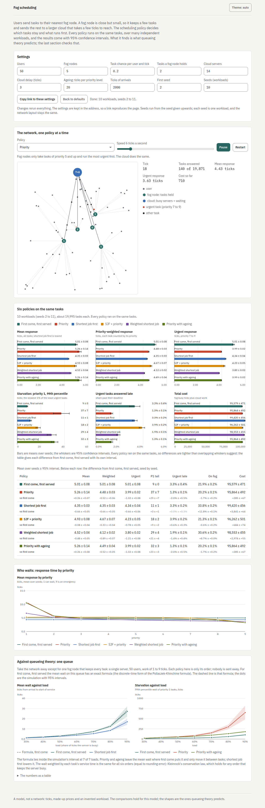

# Fog scheduling

A simulation of users, fog nodes and a cloud that runs six task scheduling policies on the same
workloads, over many seeds, and reports each result with a 95% confidence interval. A separate
check strips the network down to one queue and compares the simulator with queueing theory.



## The idea

Devices at the edge of a network, such as medical sensors, produce more tasks than they can
process. A fog node sits close to them and answers quickly, but it is small. The cloud is large,
but every task sent there pays a network delay. So someone has to decide, for every task, whether
it stays at the fog node or goes to the cloud, and what runs first. The original project built this
three-tier network as a small simulation, gave every task a priority from 1 to 9 with emergencies
in mind, and asked a direct question: if you schedule by priority, by shortest job, or by both,
what happens to response time and to cost? The good part was that it did not argue the answer, it
measured it.

This version keeps that question and makes the measurement trustworthy: a first-come baseline,
many independent workloads instead of one, intervals on every number, and two more rules, one
that weighs urgency against size and one that stops low-priority tasks from waiting forever.

None of what it finds is new. Every effect below is what queueing theory predicts for these rules,
and the last section shows the simulator agreeing with the theory where an exact answer exists.
The value is in watching it happen on a network you can change.

## How it works

Time moves in ticks. Each user is attached to its nearest fog node. On every tick each user creates
a task with a fixed probability. A task has a priority (1 to 9), an amount of work (1 to 9 units)
and a deadline (5 to 19 ticks).

Each tick, in order:

1. New tasks reach their fog node. The policy either admits a task or sends it to the cloud. If the
   node now holds more tasks than its capacity, the task the policy ranks last is sent to the cloud.
2. Tasks sent to the cloud spend `cloudLatency` ticks on the network, then join the cloud queue.
3. Each fog node works on one task, each cloud server works on one task. A started task runs to
   completion (no preemption). Free nodes and servers pick the task the policy ranks first.

|       | Fog node                            | Cloud                                |
| ----- | ----------------------------------- | ------------------------------------ |
| Speed | 3 work units per tick               | 4 work units per tick, per server    |
| Size  | holds 2 tasks                       | 14 servers ("elastic up to a point") |
| Delay | none                                | 3 ticks                              |
| Price | 2 per busy tick (reserved hardware) | 1 per work unit (pay per use)        |

These are the defaults; all of them can be changed.

| Policy                   | Kept at fog       | Order (fog and cloud)                         | Sent away when full |
| ------------------------ | ----------------- | --------------------------------------------- | ------------------- |
| First come, first served | all               | oldest first                                  | newest              |
| Priority                 | priority 5 and up | most urgent first                             | least urgent        |
| Shortest job first       | all               | shortest first                                | longest             |
| SJF + priority           | priority 5 and up | fog: most urgent, then shortest; cloud: shortest | least urgent     |
| Weighted shortest job    | all               | least work per unit of priority first         | most work per priority |
| Priority with ageing     | priority 5 and up | most urgent first, counting waiting time      | lowest aged priority |

Weighted shortest job is Smith's ratio rule: it orders by work divided by priority, which
minimises the priority-weighted waiting time on one machine. Priority with ageing gives a waiting
task one extra priority level every `ageing` ticks (20 by default). Since every task ages at the
same rate, the current time cancels out of any comparison and the order is a fixed key,
`arrival - ageing * priority`. That means a task can only be overtaken by tasks that arrive at
most `8 * ageing` ticks after it, which is a hard bound on starvation.

### Replications

One seed fixes the network layout. Each replication draws a new workload from the next seed
(seeds 2 to 11 by default) and every policy runs on that same list of tasks. Each measure is
reported as the mean over seeds with a Student t 95% interval. The difference from first come,
first served is also computed seed by seed, which gives much narrower intervals than comparing
two separate intervals, because both policies saw the same tasks.

Measured per policy: mean and 95th percentile response time (ticks from request to answer),
priority-weighted mean response, mean response of urgent tasks (priority 7 to 9) and of each
priority, the 99th percentile response of priority 1 tasks (the starvation measure), share of
tasks past their deadline, share run on fog, and cost.

## What it shows

`npm run compare`, the defaults, 10 workloads of about 20,000 tasks each:

| Policy                   |        Mean |    Weighted |      Urgent | p1 tail | Urgent late |  Total cost |
| ------------------------ | ----------: | ----------: | ----------: | ------: | ----------: | ----------: |
| First come, first served | 5.01 ± 0.08 | 5.01 ± 0.08 | 5.01 ± 0.08 |   9 ± 0 |  3.3 ± 0.4% | 95579 ± 471 |
| Priority                 | 5.26 ± 0.14 | 4.48 ± 0.03 | 3.99 ± 0.02 |  37 ± 7 |  1.3 ± 0.1% | 95864 ± 492 |
| Shortest job first       | 4.35 ± 0.03 | 4.35 ± 0.03 | 4.34 ± 0.04 |  11 ± 1 |  3.3 ± 0.2% | 99420 ± 456 |
| SJF + priority           | 4.93 ± 0.08 | 4.67 ± 0.07 | 4.23 ± 0.05 |  18 ± 2 |  3.9 ± 0.2% | 96262 ± 501 |
| Weighted shortest job    | 4.52 ± 0.04 | 4.12 ± 0.02 | 3.80 ± 0.02 |  29 ± 4 |  1.9 ± 0.1% | 98553 ± 455 |
| Priority with ageing     | 5.26 ± 0.14 | 4.49 ± 0.04 | 3.99 ± 0.02 |  32 ± 3 |  1.3 ± 0.1% | 95864 ± 492 |

`npm run compare -- --cloud-servers 13`, one cloud server fewer, so the cloud is close to full:

| Policy                   |         Mean |      Urgent |   p1 tail | Mean wait, priority 1 |
| ------------------------ | -----------: | ----------: | --------: | --------------------: |
| First come, first served | 11.54 ± 2.63 | 11.53 ± 2.61 |    26 ± 6 |                 11.51 |
| Priority                 | 23.67 ± 4.41 | 3.99 ± 0.02 |  345 ± 72 |                172.81 |
| Shortest job first       |  5.73 ± 0.74 | 5.72 ± 0.71 |   38 ± 13 |                  5.69 |
| SJF + priority           | 15.07 ± 2.43 | 11.13 ± 1.54 |  202 ± 45 |                 17.16 |
| Weighted shortest job    |  6.53 ± 1.02 | 3.81 ± 0.02 | 270 ± 136 |                 23.20 |
| Priority with ageing     | 23.62 ± 4.35 | 4.07 ± 0.15 |  112 ± 12 |                 72.73 |

- Shortest job first has the lowest mean response, as the theory of non-preemptive scheduling
  says it should, and is blind to urgency. It also costs the most: short jobs fill the fog nodes,
  which are charged per tick, and long jobs go to the cloud, which is charged per unit of work.
- Weighted shortest job has the lowest priority-weighted response and the fastest urgent tasks,
  which is what Smith's rule optimises. It pays with a longer tail for large routine tasks.
- Priority serves emergencies almost as fast but starves the least important tasks. On a busy
  cloud the slowest 1% of priority 1 tasks wait about 345 ticks, while priority 9 does not notice.
- Ageing cuts that tail to about a third and keeps urgent tasks close to strict priority. The
  `ageing` setting trades one for the other (same 13-server setup):

  | Ticks per level | p1 tail  | Urgent mean | Urgent late |
  | --------------: | -------: | ----------: | ----------: |
  |               5 |  70 ± 10 | 8.73 ± 2.18 | 21.0 ± 6.6% |
  |              10 |  85 ± 10 | 5.52 ± 1.27 |  8.5 ± 4.5% |
  |              20 | 112 ± 12 | 4.07 ± 0.15 |  1.9 ± 0.9% |
  |              40 | 149 ± 17 | 3.99 ± 0.02 |  1.3 ± 0.1% |
  |              80 | 198 ± 24 | 3.99 ± 0.02 |  1.3 ± 0.1% |

- Ageing does not change the overall mean: it only reorders who waits.
- The mix of shortest job and priority sits between the two at the defaults, which agrees with the
  conclusion of the original report. On a busy cloud its urgent tasks wait longer than under
  either parent rule, because the cloud ignores priority while most tasks end up there.

These numbers describe this model, not a real network.

## Against queueing theory: one queue

`npm run theory` removes everything except one fog node that keeps every task: a single server
with 50 users, each sending a task on a tick with a small probability, work 1 to 9 ticks. For
first come, first served this queue has an exact mean wait (the discrete-time form of the
Pollaczek-Khinchine formula; the derivation is in `src/core/theory.ts`). With 20 seeds:

| Load | Simulated    | Formula | Inside the interval |
| ---: | -----------: | ------: | ------------------- |
| 0.30 |  1.38 ± 0.06 |    1.35 | yes                 |
| 0.50 |  3.23 ± 0.11 |    3.16 | yes                 |
| 0.70 |  7.21 ± 0.33 |    7.37 | yes                 |
| 0.80 | 12.36 ± 0.73 |   12.63 | yes                 |
| 0.90 | 26.86 ± 3.38 |   28.41 | yes                 |

On the same queue the other textbook results show up as expected:

- Shortest job first has the lowest mean wait at every load (16.8 against 26.9 at load 0.9).
- Weighted shortest job has the lowest priority-weighted wait at every load.
- The wait weighted by each task's service time is identical for all six orders, to rounding
  error, on every seed. This is Kleinrock's conservation law: a non-preemptive order that keeps
  the server busy can move waiting between tasks but cannot remove it.
- Priority makes priority 1 tasks wait longer as load rises (99th percentile wait 640 at load 0.9
  against 105 for first come), and ageing holds that to 184.

### References

- A. Cobham, "Priority assignment in waiting line problems", Journal of the Operations Research
  Society of America 2(1), 70-76, 1954. Mean waits per class under non-preemptive priority.
- W. E. Smith, "Various optimizers for single-stage production", Naval Research Logistics
  Quarterly 3(1-2), 59-66, 1956. The ratio rule behind weighted shortest job.
- L. Kleinrock, "A conservation law for a wide class of queueing disciplines", Naval Research
  Logistics Quarterly 12(2), 181-192, 1965. Treated at length in his Queueing Systems,
  Volume 2: Computer Applications (Wiley, 1976).

## Run

Needs Node 23.6 or newer (it runs TypeScript directly).

```
npm install
npm run compare                           # six policies, 10 seeds, the default setup
npm run compare -- --cloud-servers 13     # a busy cloud
npm run compare -- --seeds 30 --ageing 10 # more seeds, faster ageing
npm run theory                            # the one-queue check
npm run compare -- --help                 # all options; --json for machine output
npm run dev                               # browser view at http://localhost:5173
```

The comparison takes about 2 seconds for 10 seeds on a laptop, so it stays in TypeScript; a
Rust core would not change what anyone sees.

The browser view animates one policy on the network and shows all six as interval charts, a table
with the difference from first come, first served, response time by priority, and the one-queue
check against load. The seeds run in a web worker, so the page stays responsive, and changing a
setting cancels the run in progress. Settings live in the address, so a copied link reproduces
the page. It has light and dark themes, works on a phone and can be used from the keyboard.
`npm run build` writes a static site to `dist/`. To use another port, run `PORT=4000 npm run dev`
or copy `.env.example` to `.env`.

## Test

```
npm test          # core logic, with node:test
npm run lint      # Biome: lint and format check
npm run build     # type check and production build
```

The tests check a hand-worked run, the queue order of each policy, the ageing bound, the
first-come formula and the conservation law on one queue, the t intervals, and the main findings
above over four seeds.

## Layout

```
src/core/        pure simulation: rng, model, workload, policies, sim, metrics
src/core/experiment.ts   replications and confidence intervals
src/core/theory.ts       the one-queue check and its formula
src/cli.ts       command line: compare and theory
src/web/         browser view: network animation, SVG charts, worker.ts runs the seeds
src/web/shared/  style, theme switch and fonts shared with the author's other projects
test/            tests for the core
```

The page uses IBM Plex (SIL Open Font License, `src/web/shared/fonts/OFL.txt`).

## Differences from the original

- The original fog node worked on one task and sent every other task to the cloud at once. Here a
  node has a small queue, so the order of the queue matters.
- The original cloud finished everything immediately. Here it has a limited number of servers, so
  it can be overloaded.
- The original shortest-job-first sent short jobs to the cloud. Here the longest job leaves, since
  a long job loses the least from the network delay.
- The original ran one workload. Here every comparison runs over many seeds with intervals.
- First come, first served, weighted shortest job, priority with ageing and the one-queue check
  are new.

## Credit

Rebuilt from a 2022 university project on fog and edge computing by Varun Agarwal, Anirudh Yadav
and Ruksana Tabassum.
